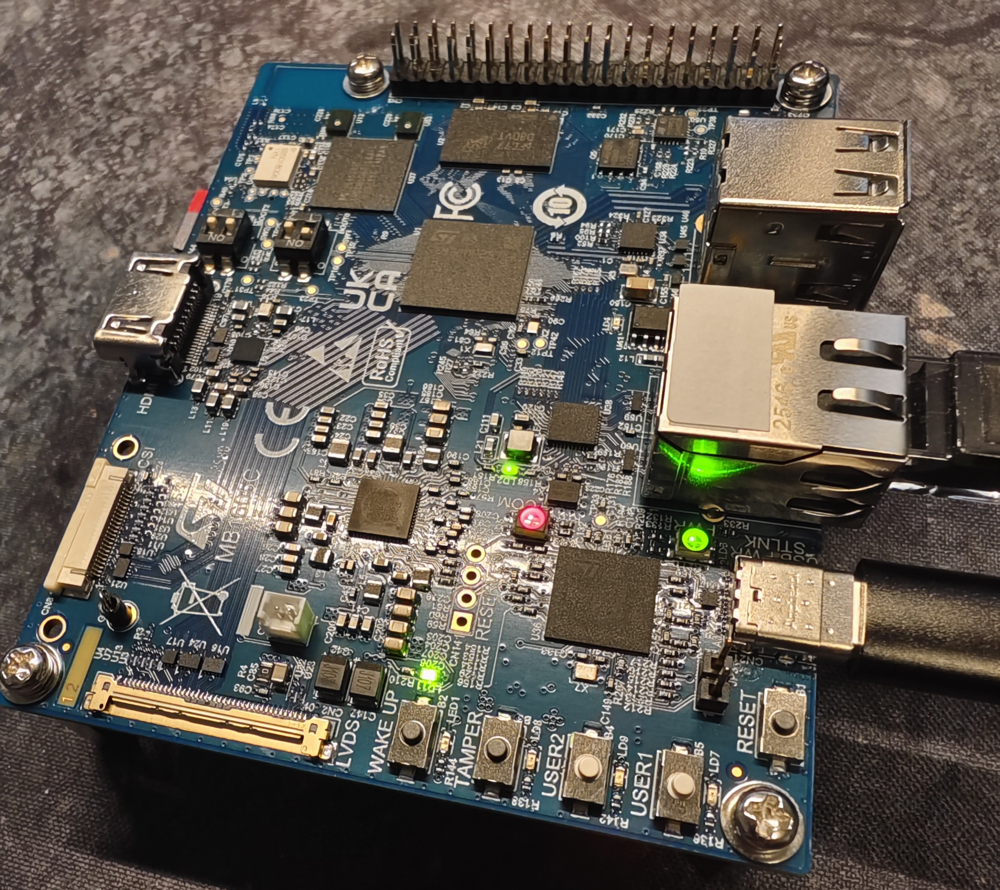

# Nanexus Media Signing Gateway

A native Gateway for signing already-encoded H.264 camera media and publishing it
as RTSP, using pinned ZLMediaKit and the official ONVIF Media Signing Framework.
Independent verification uses Nanexus Video Trust Toolkit.

**M2 K11 functional milestone: complete.** Bounded host validation covers native
camera ingest, signing, independent RTSP reception and recording by stock Frigate
0.18.2. This is a single-camera experimental runtime. M2 STM32MP2/ARM64 portability,
discontinuous motion-retention behavior and production reliability remain unqualified.

## Architecture and trust boundary

```text
H.264 camera RTSP/TCP
→ native ZLMediaKit input → bounded complete-AU admission
→ direct official ONVIF signing → transparent signed-AU RTP encoding
→ owned RTSP source → Frigate or independent receiver
→ independent Nanexus Toolkit verification
```

The native runtime preserves original NAL payload bytes/order, inserts signing
SEIs, and uses one serialized signing epoch independent of downstream readers.
It does not decode or transcode video. Toolkit is an independent verifier;
GStreamer and FFmpeg media libraries are not Gateway runtime dependencies.

A Gateway signature authenticates media observed and signed at its signing
boundary. It does not establish camera authenticity, integrity before that
boundary, trusted camera capture time or physical/event truth. Camera identity
and Gateway signing-key identity are distinct. Validation used disposable test PKI.

Publisher validity, network receipt and retained-recording completeness must be
assessed separately. An intact retained interval may verify PARTIAL when signing
context lies outside its boundaries. A verified suffix, including separately
recovered cache context, does not establish that all source media was retained.
Local EOS finalization alone does not prove downstream archival completeness.

## Build and operation

See the [native guide](docs/M2-FOUNDATION.md) for exact dependency pins, isolated
source preparation, deterministic patch application, native build and supported
configuration. The functional build requires `NANEXUS_NATIVE=ON` and explicitly
prepared dependency roots; the default build provides configuration checks only.

Use the [sanitized example](config/gateway.example.conf), storing camera credentials
and signing identities in separate private local files. Start in this order:
**Camera → Gateway → Frigate**. One H.264/TCP camera is supported, restricted to
progressive I/P video, complete marker/timestamp groups and in-band SPS/PPS+IDR
startup. See the guide for exact bounds and rejection behavior.

Normal operation supports a bounded duration or SIGINT/SIGTERM with deliberate
signing finalization. Source/signing failures stop the epoch; no automatic recovery
or reconnect is implemented. Multi-camera operation, arbitrary startup-order
support, Web UI, OTA/watchdog, appliance management and industrial qualification
are deferred. Output RTSP authentication and production PKI are not implemented.

## Source and dependency distribution

This repository contains Nanexus-owned source, minimal attributed upstream patches,
exact revision locks, build instructions and example configuration. It includes no
complete upstream source trees, compiled Gateway binaries, signing identities,
firmware images or internal experiment evidence. Local dependency checkouts and
build outputs belong under ignored build directories.

Nanexus-owned source is [Apache-2.0](LICENSE). External dependencies and adapted
patches retain their own terms; see [third-party notices](THIRD_PARTY_NOTICES.md)
and [patch provenance](patches/README.md). ZLMediaKit service attribution must be
preserved. ZLToolKit includes LGPL Base64 and additional file-level notices;
final distribution/license and corresponding-source/relinking review remains a
release gate. This project makes no ONVIF certification or endorsement claim.

## Preserved M1 baseline

M1 demonstrated embedded live H.264 signing to an Annex-B file on STM32MP257F-DK.
Its v0.1.0 history and [bounded proof source/guide](tools/live-signing-proof/README.md)
remain preserved. That historical executable uses its own GStreamer/Toolkit path;
it is not linked into M2, and its CLI/file workflow is not an M2 compatibility
contract. M1 hardware results do not qualify the new native M2 runtime on ARM64.



Never commit camera/LAN credentials, private signing keys or raw private diagnostics.
Interfaces and packaging remain experimental; public release is a separate decision.
