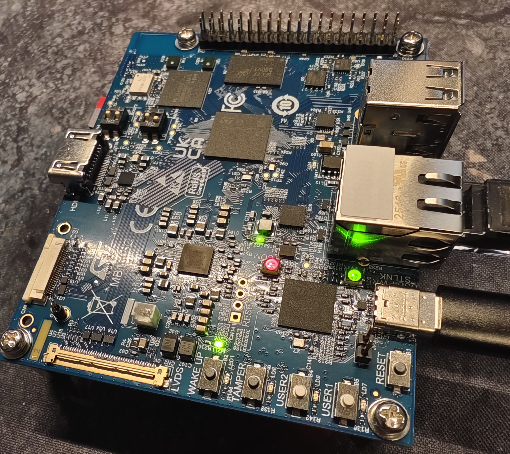

# Nanexus Media Signing Gateway

**An embedded gateway for adding ONVIF Media Signing to existing IP cameras.**

Many installed IP cameras can stream H.264 video over RTSP but do not support cryptographic media signing. Nanexus Media Signing Gateway demonstrates how these cameras can gain ONVIF-based media-signing capabilities through an external gateway, without replacing the cameras or modifying their firmware.

The project also provides a standards-based signing source for developers and researchers evaluating how NVR/VMS systems preserve, record, and verify signed video. It offers a practical reference for exploring the integration of media signing into existing video-surveillance workflows.

The gateway receives up to four compatible cameras' H.264 RTSP streams, adds ONVIF Media Signing information independently to each stream, and republishes four separate signed RTSP outputs for recording, monitoring, or independent verification. It operates on already-encoded video, without decoding or transcoding the original streams.

**v0.3.0 — Four-Channel Functional Prototype**

## How It Works

```text
                    Nanexus Media Signing Gateway
                   ┌─────────────────────────────┐
                   │                             │
 IP Camera         │   RTSP Ingest               │         NVR / VMS
 (H.264 / RTSP) ──►│        ↓                    │────────► Recording
                   │   ONVIF Media Signing       │
                   │        ↓                    │         Independent
                   │   Signed RTSP Output        │────────► Verification
                   │                             │
                   └─────────────────────────────┘
```

The gateway sits between an existing camera and downstream systems.

The diagram represents one channel. Up to four channels run as separate worker processes, each with its own camera connection, signing context, RTSP listener and recovery. All workers use one configured Gateway signing identity.

It does not require the camera to implement ONVIF Media Signing. Instead, signing is performed at the gateway, using its own configured signing identity.

The resulting stream can be consumed by RTSP-compatible software, while ONVIF Media Signing-compatible verification tools, including the [Nanexus Video Trust Toolkit](https://github.com/Nanexus-AI/nanexus-video-trust-toolkit), can independently verify the signed video and inspect its signing evidence.

Signing authenticates video from the gateway's signing boundary onward; it does not establish the authenticity of the camera's original capture.

## Embedded Reference Platform



The functional prototype has been implemented and tested on the **STMicroelectronics STM32MP257F-DK**, running a compatible OpenSTLinux environment.

The device operates as a standalone RTSP signing gateway: it connects to an existing camera, signs the incoming video, and makes the resulting stream available to downstream receivers over the network.

The implementation combines:

- **ZLMediaKit** for RTSP input and output, pinned to commit `08329b39bf36c141b0a12c2bcceb819456632d9b`.
- **The official ONVIF Media Signing Framework** for signing, pinned to release `r25.12.6` (commit `cf7785ab993c18d921094e8e505c2c34a1350f28`).
- **Nanexus Gateway components** for integration, configuration, signing workflow, and runtime control.

ZLMediaKit's ZLToolKit dependency is also pinned to the validated commit `d7d601200f65f3111dbf9d20ed7f14d2654bbd6e`. The source preparation process applies the required Nanexus patches to the exact upstream revisions.

These components operate within each Gateway worker executable. No separate ZLMediaKit MediaServer or ONVIF signing daemon is required.

## What the Prototype Provides

**Signing for existing cameras**

A compatible H.264 RTSP camera can provide video to the gateway without native media-signing support.

**Signed RTSP output**

The gateway adds ONVIF signing metadata while retaining the admitted encoded video payloads, and publishes the result as an RTSP stream.

**Independent verification**

The signed stream can be recorded and subsequently examined using an independent ONVIF-compatible verification workflow, including the [Nanexus Video Trust Toolkit](https://github.com/Nanexus-AI/nanexus-video-trust-toolkit).

**Embedded standalone operation**

The gateway runs on the STM32MP257F-DK under Linux, with a persistent service configuration demonstrated on the reference platform.

**Independent channels and recovery**

One to four workers share a Gateway signing identity while keeping their signing sessions and RTSP outputs separate. The supplied systemd services restart a failed channel independently; recovery starts a new signing session.

**Integration with existing recording systems**

The prototype has been exercised with Frigate, a widely used open-source NVR. The experiments demonstrate that signing information can survive ordinary MP4 recording segmentation and remain available for independent historical verification.

## What Has Been Demonstrated

The native implementation has been tested on a Linux development host and the STM32MP257F-DK reference platform. Four simultaneous controlled H.264 inputs exercised independent signing, signed RTSP publication, original encoded-payload preservation and verification. Deliberately finalized receiver captures verified VALID and complete.

Reference-board fault tests exercised an unavailable input, source loss, worker termination and a per-worker memory-limit fault. The affected channel recovered while the other workers continued without restarting. This establishes the tested process-level recovery behavior, not continuity across a restarted signing session.

Three physical H.264 cameras, including a Tapo C210 and two additional IP cameras, were also exercised concurrently. Receiver recordings verified with signature integrity ok and continuity intact; their overall PARTIAL results retained a pending tail because the receivers stopped while signing continued. This is not a four-physical-camera or universal compatibility claim.

Frigate integration experiments demonstrated that signing metadata survives ordinary MP4 recording segmentation. Retained files can be PARTIAL with intact signatures and an unresolved tail; recording coverage and gaps must be evaluated separately. Earlier single-channel tests involving intentionally unretained intervals also demonstrated that missing signing history can be detected during cross-gap verification.

These results establish the core functionality of an operational embedded signing-gateway prototype. They do not imply compatibility with every camera, NVR, video format, or recording policy.

More detailed implementation and validation information is provided in the technical documentation.

## Build, Install, and Verify

This project is distributed as **Nanexus-owned source code and small upstream patches**, rather than a complete redistribution of third-party media-server sources or prebuilt firmware.

Users obtain the specified upstream revisions, apply the provided patches through the dependency preparation process, and build the Gateway for a supported environment.

The documented workflow is:

1. Obtain and prepare the pinned dependencies.
2. Build the Gateway and required ONVIF signing library.
3. Configure one to four camera endpoints, separate output listeners and a shared signing identity.
4. Start the configured workers, using the supplied systemd services for independent retries.
5. Connect an RTSP receiver or recording system to each signed output.
6. Preserve signed video and verify it independently.

### Documentation

- [Native Linux build and configuration](docs/M2-FOUNDATION.md)
- [STM32MP257F-DK ARM64 build, installation, and operation](docs/M2-ARM64.md)
- [Recording and independent signature verification](docs/M2-VERIFICATION.md)
- [Gateway configuration example](config/gateway.example.conf)
- [Four-channel configuration, services and verification](docs/FOUR-CHANNEL.md)
- [Four-channel configuration example](config/gateway-four-channel.example.conf)
- [Upstream dependencies and patches](patches/README.md)

For normal standing operation with a sectioned configuration, start each worker with `nanexus-gateway --config FILE --channel camN`. The legacy single-channel configuration and `nanexus-gateway --config FILE` invocation remain supported. The detailed guides cover dependency versions, build commands, signing identity setup, service installation, and verification procedures.

## Four-Channel Operation

Use `[gateway]` for the shared signing identity and `[channel.cam1]` through
`[channel.cam4]` for each input and output. Each configured channel needs a distinct
listener port. The example uses ports 18554–18557 and paths `/signed/camera1`
through `/signed/camera4`. For remote NVR access, replace the example's loopback
bind addresses with appropriate local listener addresses and give the NVR the
Gateway's reachable IP. See the [four-channel guide](docs/FOUR-CHANNEL.md) for
configuration checking, service installation and migration from a single channel.

## Scope and Current Limitations

**v0.3.0 is a functional prototype, not a production-ready security appliance.**

The implementation supports one to four H.264 RTSP/TCP inputs on the native media path. Four-channel controlled-input validation and three-camera physical-input observations do not establish a qualified maximum channel capacity for arbitrary workloads.

The prototype demonstrates the complete core signing workflow, but does not yet provide production-level device management, security hardening, broad camera compatibility, or qualified 24/7 unattended reliability.

In particular:

- The supplied services retry failed workers independently. A restart creates a new signing session; continuity across outages or recovery from every possible failure is not claimed.
- H.265, B frames, output RTSP authentication/TLS and qualified high-load or 24/7 operation are outside the validated scope. Use a controlled network.
- Signing establishes authenticity at the gateway boundary, not at the camera sensor.
- Recording gaps may interrupt cross-interval verification even when the retained portions verify independently.
- ONVIF Media Signing Add-on certification is not claimed.

Detailed protocol, signing-continuity, verification-status, and platform-specific limitations are described in the technical guides.

## Source Code and Licensing

Nanexus-owned source code is provided under the [Apache License 2.0](LICENSE).

The project relies on explicitly pinned upstream revisions of ZLMediaKit, ZLToolKit, and the official ONVIF Media Signing Framework. The published modifications to upstream projects are provided as minimal differential patches, with applicable upstream copyright and license terms retained.

The repository does not redistribute complete upstream source trees, compiled third-party libraries, operating-system images, or signing credentials.

See [Patch and dependency information](patches/README.md) and [Third-Party Notices](THIRD_PARTY_NOTICES.md).

## Acknowledgments

We gratefully acknowledge the open-source projects that make this gateway possible:

- **[ZLMediaKit](https://github.com/ZLMediaKit/ZLMediaKit)** and its contributors, for providing the RTSP media infrastructure on which the gateway is built.
- **[ONVIF Media Signing Framework](https://github.com/onvif/media-signing-framework)** and its contributors, for providing the open-source implementation of ONVIF Media Signing used by this project.

Their work provides the foundation for integrating media signing into existing camera and video-recording workflows.

## Project Evolution

**Milestone 1 — v0.1.0: Initial Signing Gateway Prototype**

The first milestone demonstrated the initial media-signing approach and established its feasibility. Its historical implementation and supporting proof remain available in the [v0.1.0 tag](https://github.com/Nanexus-AI/nanexus-media-signing-gateway/tree/v0.1.0).

**Milestone 2 — v0.2.0: Embedded Functional Gateway Prototype**

The second milestone introduces a substantially different architecture, integrating native ZLMediaKit-based RTSP handling with the official ONVIF Media Signing Framework in an independently runnable embedded gateway.

Version v0.2.0 replaced the earlier architecture; the GStreamer-based Milestone 1 adapter is not required by the native versions.

The release provides a reproducible, openly available implementation for experimentation and integration with recording and independent verification systems.

**v0.3.0 — Four-Channel Functional Prototype**

This version extends the native media path to one to four independent workers,
with a shared Gateway signing identity, separate RTSP listeners and per-channel
systemd recovery. It retains legacy single-channel configuration support and the
same pinned upstream dependencies and patches. Distribution remains source code,
small patches and build/operation instructions; no prebuilt appliance image or
signing identity is supplied.
